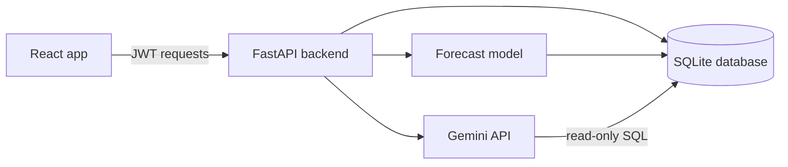

# 🛒 Smart Inventory

**An intelligent inventory and business assistant for small retail shops, built with machine learning and natural language processing.**

---

## 📌 Table of contents

1. [Problem statement](#-problem-statement)
2. [Features](#-features)
3. [Architecture](#-architecture)
4. [Data: what is real and what is simulated](#-data-what-is-real-and-what-is-simulated)
5. [Machine learning results](#-machine-learning-results)
6. [Reorder logic](#-reorder-logic)
7. [Tech stack](#-tech-stack)
8. [Project structure](#-project-structure)
9. [Getting started](#-getting-started)
10. [API overview](#-api-overview)
11. [Security](#-security)
12. [Limitations and future work](#-limitations-and-future-work)
13. [Author](#-author)

---

## 🎯 Problem statement

Many small shops still manage stock, sales, expiry dates, and suppliers in notebooks, spreadsheets, or on paper. They run out of fast-selling items, overstock slow ones, miss expiry dates, and cannot easily see their profit. Commercial ERP systems are too costly and complex for them.

**Smart Inventory** is a lightweight assistant that:

- 🔮 forecasts demand for each product with machine learning,
- 📦 recommends what to reorder, how much, and from which supplier,
- ⏳ warns about perishable batches that are close to expiry and unlikely to sell in time,
- 💰 shows daily revenue and profit,
- 🧾 records sales by barcode scan and deducts stock automatically,
- 💬 answers plain-language questions such as *"What should I order tomorrow?"*

---

## ✨ Features

| | Feature | Details |
|---|---|---|
| 🔮 | **Demand forecasting** | Gradient boosting model on daily sales (lags, rolling averages, weekday), forecasting the next 7 open days per product |
| 📦 | **Reorder recommendations** | Safety stock, reorder point, and order quantity from the forecast, using the cheapest supplier's lead time and cost |
| ⏳ | **Expiry alerts** | Only for perishable products. Shows expired, critical, warning, and watch batches, plus units and value at risk |
| 🧾 | **Sales with barcode scanning** | Camera scanning (ZXing) and USB scanner support; stock is deducted from the batch that expires first |
| ➕ | **Add products and receive stock** | New products can be perishable or not; an expiry date is required for perishables and rejected for the rest |
| 💰 | **Profit summary** | Daily revenue, cost, profit, and margin, plus a 7-day trend chart |
| 💬 | **Ask your shop** | Natural-language questions turned into safe, read-only SQL by Gemini, then answered in plain words |
| 🔐 | **Authentication** | Register and log in with JWT tokens and bcrypt-hashed passwords |
| 🌙 | **Interface** | Responsive React dashboard, rupee (₹) formatting, dark mode |

---

## 🏗️ Architecture



1. The React app logs in and receives a JWT, which it sends with every request.
2. The FastAPI backend reads and writes the SQLite database.
3. The forecast model reads live sales from the database, so every new sale feeds the next forecast.
4. The "Ask your shop" feature sends the question and the table structure to Gemini. Gemini writes a query, which the backend validates and runs on a read-only connection.

---

## 📊 Data: what is real and what is simulated

> ⚠️ **Please read this section.** No real shop's inventory data is public, so this project combines one real dataset with clearly labelled simulated data.

| Part | Source | Status |
|---|---|---|
| Sales history for 50 gift and home products (about 103,000 line items) | [Online Retail II](https://archive.ics.uci.edu/dataset/502/online+retail+ii) from the UCI Machine Learning Repository, a UK online retailer, 2009 to 2011 | ✅ **Real transactions.** Prices converted from pounds to rupees at a fixed rate of ₹130 per £, and dates shifted forward by exactly 776 weeks (weekdays preserved) so the demo looks current |
| Suppliers, supplier prices, stock batches, cost prices | Generated by `pipeline/09_add_synthetic_data.py` | 🧪 **Simulated** |
| 15 Indian food items (milk, bread, curd and others) with prices, shelf lives, 90 days of sales, batches and supplier quotes | Generated by `pipeline/12_add_food_items.py`; prices are approximate typical shop prices | 🧪 **Simulated.** Sales rows are marked with invoice `SIM` |
| Expiry dates | Only the 15 food items have shelf lives | 🧪 **Simulated.** Gift and home items do not expire |
| Profit and margin figures | Revenue is real or simulated sales; cost uses the average of the simulated supplier quotes | 🧪 **Demo figures only** |

What this means for the results:

- The **forecasting accuracy** below is measured only on the **real** Online Retail II sales, which are not affected by the currency and date changes.
- Profit, margins, supplier comparisons, and expiry results come from simulated data and show how the system behaves. They are **not findings about a real business**.
- The app's "today" is a stored date (`as_of_date` in the `settings` table), not the computer's clock.
- The food items' sales were generated, so any forecast on them demonstrates the pipeline, not model accuracy.

---

## 📈 Machine learning results

**Task:** predict the next day's quantity sold for each product, repeated to forecast 7 open days.

**Model:** scikit-learn `HistGradientBoostingRegressor` with absolute-error loss.

**Features (scale-free):** quantity 1, 2, 7, and 14 open days ago, 7-day rolling mean and standard deviation, and weekday, all divided by the product's 28-day average so that fast and slow sellers are treated alike.

**Evaluation:** time-based split. The model trains on earlier data and is tested on the **last 60 open days** (2 October to 9 December 2011 in the original data), which includes the Christmas season. The test set has 3,000 product-day rows with an average of 54.5 units per day.

| Method | Mean absolute error (lower is better) |
|---|---|
| Same weekday last week | 57.61 |
| Average of last 7 days | 45.80 |
| Average of last 28 days | 43.61 |
| **Gradient boosting model** | **38.12** |

The model beats the best simple baseline by about **12.6%**. This is a modest but real improvement. The data comes from a wholesale-style shop with large bulk orders, so daily quantities are very spiky and some error is unavoidable.

A first attempt, with absolute month and product-code features and the default loss, did **not** beat the baselines (error 47.12 against 45.8). Making the features scale-free, using an absolute-error loss, and removing the product and calendar-year features fixed this.

**New products:** a product with fewer than 28 days of sales has too little history for the model, so its forecast falls back to its average daily sales.

---

## 🧮 Reorder logic

For each product, using the supplier with the lowest cost price:

| Quantity | Formula |
|---|---|
| Demand during delivery | Sum of the forecast over the supplier's lead time |
| Safety stock | `1.65 × standard deviation of daily sales (last 28 days) × √lead time` (95% service level) |
| Reorder point | Demand during delivery + safety stock |
| Order quantity | Demand during delivery + 7 days of forecast demand + safety stock − current stock |

A product needs ordering when its current stock is at or below its reorder point. Expired batches are not counted as stock.

---

## 🧰 Tech stack

| Area | Tools |
|---|---|
| Data and ML | Python, pandas, NumPy, scikit-learn, joblib, Matplotlib |
| Backend | FastAPI, Uvicorn, SQLite, PyJWT, bcrypt, python-dotenv |
| Natural language | Google Gemini API (`google-genai`), text-to-SQL with safety checks |
| Frontend | React, Vite, ZXing (barcode scanning), plain CSS |
| Tooling | Git, VS Code |

---

## 🗂️ Project structure

```
smart-inventory/
├── backend/          FastAPI app: main.py, auth.py, ask.py
├── frontend/         React app (Vite)
├── ml/               forecast.py, reorder.py, analytics.py, trained model
├── pipeline/         One-time data and training scripts (01 to 12)
├── data/             raw/ and processed/ (not committed), inventory.db (generated)
├── reports/          Charts from the data exploration
├── docs/screenshots/ Images used in this README
├── requirements.txt
└── README.md
```

---

## 🚀 Getting started

**Prerequisites:** Python 3.10 or newer, Node.js 18 or newer, and Git.

### 1. Clone and set up Python

```bash
git clone https://github.com/<your-username>/smart-inventory.git
cd smart-inventory
python -m venv venv
venv\Scripts\activate          # Mac/Linux: source venv/bin/activate
pip install -r requirements.txt
python -c "import os; [os.makedirs(p, exist_ok=True) for p in ['data/raw','data/processed']]"
```

### 2. Add the dataset

Download **Online Retail II** from the [UCI repository](https://archive.ics.uci.edu/dataset/502/online+retail+ii), unzip it, and place `online_retail_II.xlsx` in `data/raw/`. Check the dataset's licence and terms before reusing it.

### 3. Create your `.env` file

Create a file named `.env` in the project root:

```
SECRET_KEY=<generate with: python -c "import secrets; print(secrets.token_hex(32))">
GEMINI_API_KEY=<free key from https://aistudio.google.com>
GEMINI_MODEL=gemini-2.5-flash
GEMINI_FALLBACK_MODELS=gemini-3.5-flash,gemini-3.5-flash-lite,gemini-2.5-flash-lite
```

> 🔒 Never commit `.env`. It is already listed in `.gitignore`. The Gemini variables are only needed for the "Ask your shop" page, and model names change over time, so pick current Flash models from AI Studio.

### 4. Build the data and the model

Run the scripts **from the project root, in this order**:

```bash
python pipeline/01_load_data.py            # read the Excel file, save a CSV
python pipeline/02_clean_data.py           # remove cancellations, bad rows, non-products
python pipeline/03_explore.py              # charts and the product summary (needed later)
python pipeline/04_build_daily.py          # daily sales for the 50 best-selling products
python pipeline/05_train_model.py          # features and a first model comparison
python pipeline/06_improve_model.py        # improved model against three baselines
python pipeline/07_save_model.py           # train on all data, save ml/demand_model.joblib
python pipeline/08_create_database.py      # SQLite database: products and sales
python pipeline/09_add_synthetic_data.py   # suppliers, stock batches (simulated)
python pipeline/10_localize_demo_data.py   # convert to rupees, shift dates to 2026
python pipeline/11_remove_invalid_expiry.py# remove expiry from non-perishable items
python pipeline/12_add_food_items.py       # add 15 simulated food items
```

> Scripts `08` and `09` reset the database, so rerun scripts `08` to `12` together if you ever need to start over.

### 5. Run the app

```bash
# Terminal 1: backend (project root)
uvicorn backend.main:app --reload

# Terminal 2: frontend
cd frontend
npm install
npm run dev
```

Open <http://localhost:5173>, register an account, and log in. The interactive API documentation is at <http://127.0.0.1:8000/docs>.

---

## 🔌 API overview

All endpoints except `/health`, `/auth/register`, and `/auth/login` need a `Bearer` token.

| Method | Endpoint | Purpose |
|---|---|---|
| `GET` | `/health` | Check that the server is running |
| `POST` | `/auth/register` | Create an account |
| `POST` | `/auth/login` | Log in and receive a JWT (valid for 60 minutes) |
| `GET` | `/auth/me` | Current user |
| `GET` | `/products` | Products with current sellable stock |
| `POST` | `/products` | Add a product (with an optional shelf life) |
| `POST` | `/stock/receive` | Receive stock; the expiry date is validated against the product |
| `POST` | `/sales` | Record a sale and deduct stock, earliest expiry first |
| `GET` | `/reorder` | Reorder recommendations from the forecast |
| `GET` | `/alerts/expiry` | Batches expiring within 30 days |
| `GET` | `/summary/daily` | Revenue, cost, profit, and margin per day |
| `POST` | `/ask` | Natural-language question about the shop's data |

---

## 🔐 Security

- Passwords are stored as **bcrypt** hashes, never as plain text.
- Sessions use **JWT** tokens that expire after 60 minutes.
- Secrets live in `.env`, which is excluded from version control.
- The "Ask your shop" feature runs model-written SQL under strict rules: a **read-only** database connection, a **table allowlist** that blocks the users table, single `SELECT` statements only, a 5-second time limit, and a 50-row cap.
- Sales and stock endpoints validate inputs, for example rejecting more sales than stock and expiry dates on non-perishable products.

---

## ⚠️ Limitations and future work

- Single shop and single user role; there are no staff permissions.
- The forecast model is trained once and not retrained automatically as new sales arrive.
- Profit, supplier, and expiry numbers come from simulated data (see the data section above).
- Stock codes from the dataset are not real printed barcodes. For demos, generate a Code 128 barcode of a stock code.
- "Ask your shop" depends on a free-tier LLM, so answers can be slow and are limited by the free quota. Free-tier data may be used by the provider, so do not send real customer data through it.
- There are no automated tests yet.

**Ideas for the future:** automated retraining, purchase orders sent to suppliers, PostgreSQL, Docker deployment, a mobile app, and alerts by WhatsApp or SMS.

---

## 👩‍💻 Author

**Poojitha Menon**

[GitHub](https://github.com/Poojithamenon06)

Built as an end-to-end machine learning and full-stack project.
